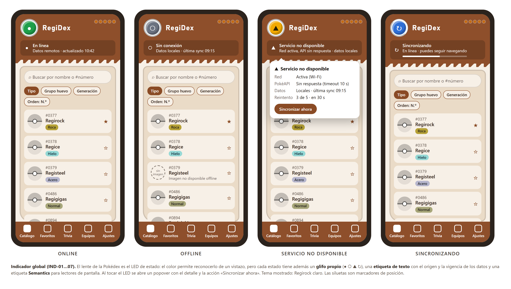
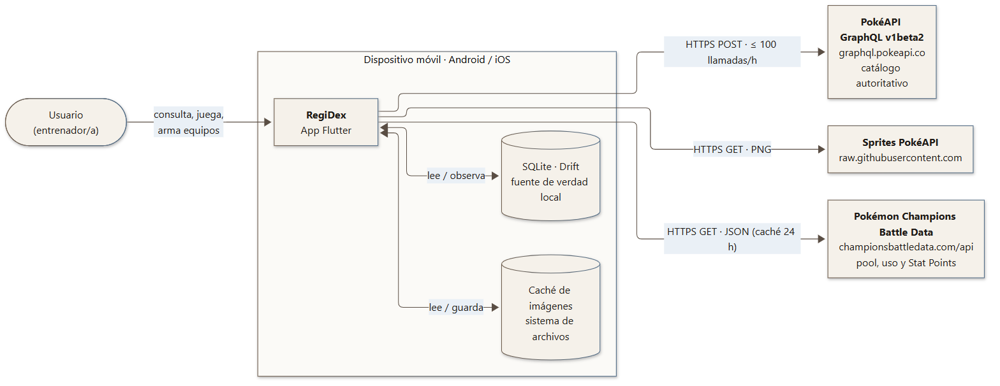
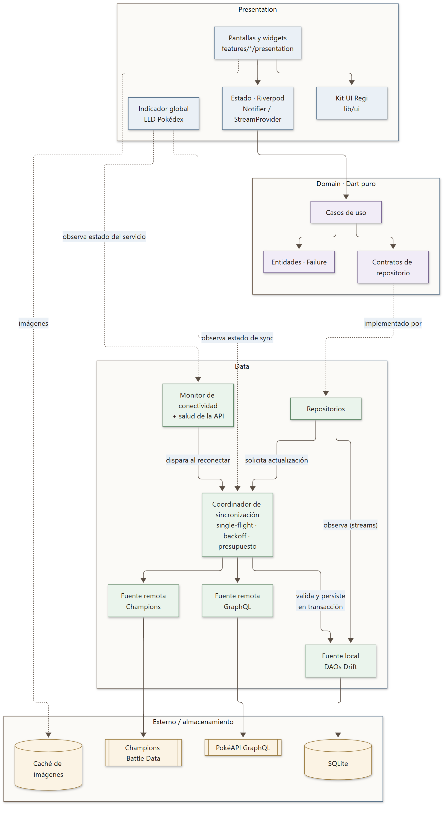
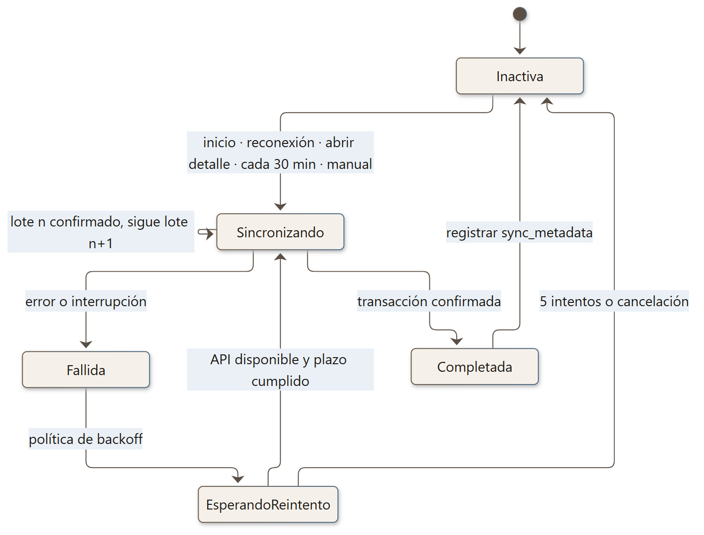
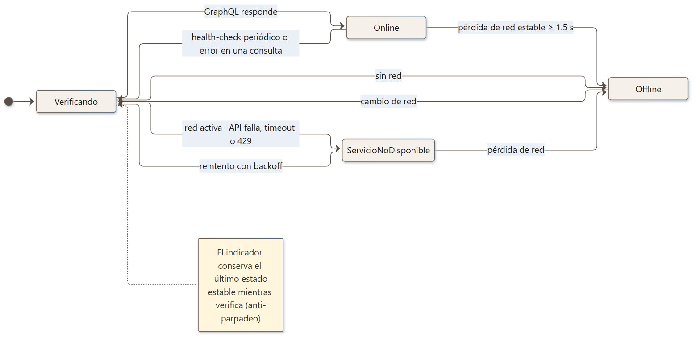
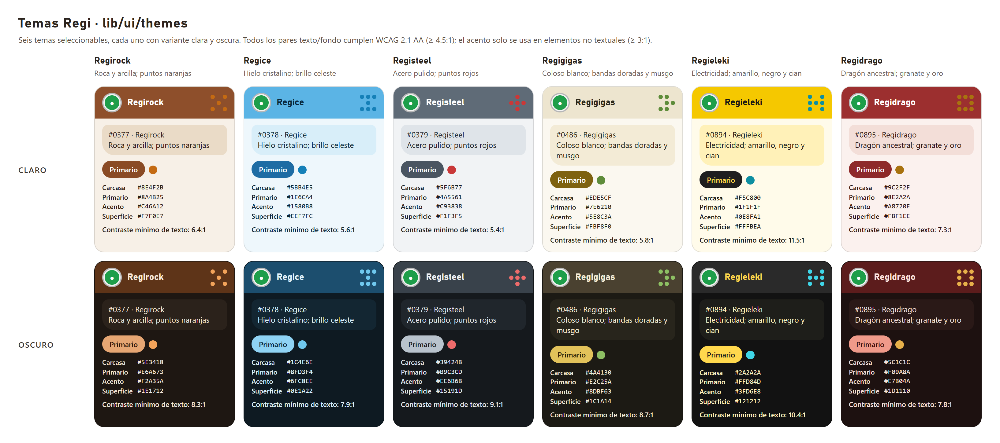
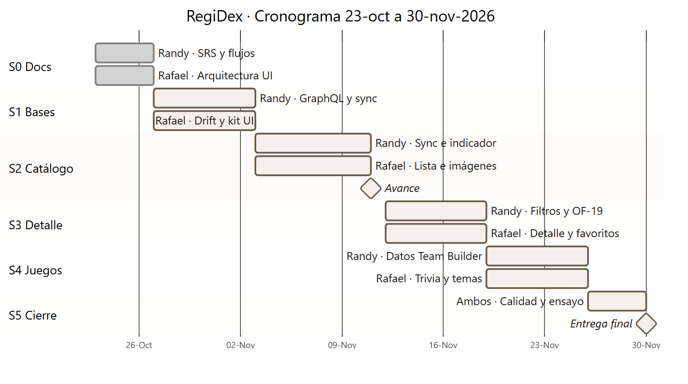

# RegiDex · Enciclopedia Pokémon de todas las Épocas

Pokédex móvil para **Android e iOS** construida con **Flutter**, que consume la API **GraphQL de PokéAPI** con una arquitectura **Offline-First + Online-Preferred**. Tiene temática de los Regis, interfaz de Pokédex moderna, trivia y un creador de equipos para **Pokémon Champions**.

> Proyecto final de **Desarrollo de Aplicaciones Móviles**: Pontificia Universidad Católica Madre y Maestra (PUCMM), Escuela de Ingeniería en Computación y Telecomunicaciones. Docente: Freddy Peña.

## Integrantes

| Integrante | Rol principal |
|---|---|
| **Randy A. Germosén** | Datos y sincronización: GraphQL, conectividad, sync, búsqueda y filtros, integridad, datos del Team Builder. |
| **Rafael J. Ramírez** | Persistencia e interfaz: Drift, kit UI Regi, catálogo, detalle, favoritos, trivia, UI del Team Builder. |

Ambos trabajamos en todas las capas y revisamos el código del otro mediante pull requests.

## Estado del proyecto

| Hito | Fecha | Estado |
|---|---|---|
| Sprint 0: documentación, diagramas y planificación | 23–26 oct 2026 | ✅ Completado |
| Sprint 1: fundaciones (estructura, DI, Drift, cliente GraphQL, monitor de conectividad, kit UI) | 27 oct – 2 nov 2026 | ✅ Completado |
| Sprint 2: catálogo offline (sync paginada, repositorio, lista observada, indicador de conexión) | 3–10 nov 2026 | ✅ Completado |
| Entrega de **Avance** (≈40 %) | 11 nov 2026 | ⏳ Preparada; se demuestra en clase |
| **Entrega final** y defensa | 30 nov 2026 | ⏳ Pendiente |

Lo que todavía no está implementado se marca como *planificado* en cada sección.

## Avance del 11 de noviembre

Dónde está cada entregable del avance y cómo se comprueba.

| # | Entregable | Dónde está | Cómo se comprueba |
|---|---|---|---|
| 1 | Estructura por funcionalidades con capas | `lib/features/<feature>/{presentation, domain, data}`, más `lib/core/` y `lib/ui/` (§6) | `test/architecture/layer_rules_test.dart` impone las reglas de dependencia entre capas |
| 2 | Modelo de datos local | Drift v1 con 17 tablas: referencia, catálogo, favoritos, preferencias, `sync_metadata` y `api_call_log` (`lib/core/database/`; esquema en `drift_schemas/drift_schema_v1.json`) | `test/core/database/` |
| 3 | GraphQL con paginación y sin duplicados | `CatalogSync`: lotes de 200 con upsert por clave primaria (`lib/features/pokemon/data/catalog_sync.dart`) | `catalog_sync_test.dart`: tres sincronizaciones seguidas dejan los mismos conteos (PA-13) e interrumpir y reanudar no pierde ni repite filas (PA-09). Corrida real contra PokéAPI el 7 de noviembre: 1025 Pokémon, y la segunda pasada con los mismos conteos |
| 4 | Fuente de lectura local | `PokemonRepository` (contrato en `domain`) sobre Drift; la pantalla solo observa `catalogStateProvider` | `layer_rules_test.dart`: `presentation` no importa GraphQL, Drift ni DTOs; `pokemon_repository_test.dart` |
| 5 | Interfaz sin bloqueos | `main()` solo hace `runApp`; la sync arranca sin esperarla (`catalogAutoSyncProvider`) y el mapeo de cada lote corre en un isolate | `catalog_auto_sync_test.dart` y `pokemon_mapper_test.dart` (paso por isolate) |
| 6 | Catálogo funcional | `catalog_page.dart` y `pokemon_tile.dart`: nombre, número, imagen y tipos; estados `CatalogLoading`, `CatalogLoaded`, `CatalogEmpty` y `CatalogError`, con «Reintentar» | `catalog_page_test.dart`, `catalog_state_test.dart` y `pokemon_tile_test.dart` |
| 7 | Offline, también tras reiniciar | Lectura siempre desde Drift; `sync_metadata` guarda la última sync; las imágenes van a una caché de disco | `test/app/restart_offline_test.dart` (PA-03, PA-04) y `pokemon_repository_test.dart` |
| 8 | Indicador Online/Offline con texto e icono | `StatusLed` en la carcasa (`AppShell`), alimentado por `shellStatusProvider` (§11) | `shell_status_test.dart`, `app_smoke_test.dart` y `restart_offline_test.dart` |
| 9 | Documentación inicial | Este README, con la arquitectura, la sincronización y los ADR-001 y ADR-005 completos, y el historial de commits de ambos | `git shortlog -sn` |

## Documentación

| Documento | Contenido |
|---|---|
| [Especificación de Requisitos (SRS)](docs/SRS_RegiDex.pdf) | Alcance, requisitos funcionales y no funcionales, casos de uso, criterios de aceptación y trazabilidad. |
| [Documento de Arquitectura](docs/Arquitectura_RegiDex.pdf) | Offline-First, persistencia y sincronización, GraphQL, conectividad, sistema de diseño Regi, **ADRs** y los 18 diagramas del proyecto (secuencias, modelo de datos, navegación…). |
| [Enunciado del Proyecto Final](docs/project/) | Requisitos oficiales de la asignatura. |

---

## 1. Descripción del proyecto

RegiDex permite:

- Consultar los **1025 Pokémon** de la Pokédex Nacional y su detalle: estadísticas, habilidades, evoluciones, movimientos, efectividad de tipos, formas y versión shiny.
- Gestionar **favoritos**.
- Jugar una **trivia** de siluetas.
- Armar **equipos para Pokémon Champions** (Singles y Dobles) con validación de Stat Points.

Todo funciona **con o sin conexión**: la interfaz siempre se construye desde la base local, y la app la actualiza en segundo plano cuando PokéAPI está disponible.

**Lo propio de nuestra versión:**

- Interfaz de **Pokédex moderna**. El lente superior es el **LED** del indicador global de conexión: se reconoce por su color, y al tocarlo muestra un *tooltip* con el detalle.
- **Seis temas** inspirados en los Regis: Regirock, Regice, Registeel, Regigigas, Regieleki y Regidrago, en claro y oscuro.
- **Búsqueda por nombre o número nacional** («25», «#025» o «pika»).
- **Filtros** por tipo, generación, **grupo huevo** y habilidad, con orden por nombre, número o total base.
- **Team Builder de Pokémon Champions**:
  - Pool de la regulación vigente.
  - Habilidad, objeto, naturaleza y 4 movimientos por miembro.
  - **Stat Points**: hasta 32 por estadística y 66 en total.
  - Sugerencias según el uso real en la escalera.
  - Exportación en formato Showdown.



## 2. Requisitos de ejecución

| Herramienta | Versión |
|---|---|
| Flutter | Canal estable compatible con Dart `^3.13` (ver `pubspec.yaml`) |
| Android | SDK con API 24 (Android 7.0) o superior; emulador o dispositivo físico |
| iOS *(opcional)* | macOS con Xcode; iOS 13 o superior |
| Red | Opcional después de la primera sincronización |

## 3. Instalación

```bash
git clone git@github.com:randy-pucmm/regi_dex.git
cd regi_dex
flutter pub get
dart run build_runner build   # genera el código de Drift (los *.g.dart no se versionan)
flutter run
```

## 4. Tecnologías y justificación (*planificado*)

| Paquete | Uso | Justificación |
|---|---|---|
| `flutter_riverpod` | Estado e inyección de dependencias | Providers testeables y sustituibles; encaja con los streams de Drift (ADR-002). |
| `drift` + `drift_flutter` | Persistencia local | SQL tipado, consultas reactivas, transacciones y migraciones (ADR-001). |
| `graphql` | Cliente GraphQL | Cliente Dart puro; lo usamos sin caché porque la fuente de verdad es Drift (ADR-003). |
| `http` | Transporte HTTP | Cliente del enlace GraphQL: fija el timeout de conexión y permite simular el servidor en las pruebas. |
| `connectivity_plus` | Eventos de red | Disparador del health-check contra PokéAPI (ADR-007). |
| `clock` · `fake_async` (dev) | Reloj | Reloj inyectable y reloj falso para probar la histéresis y los reintentos sin esperas reales. |
| `crypto` | Integridad | SHA-1 del `content_hash` de cada Pokémon (ADR-006). |
| `cached_network_image` + `flutter_cache_manager` | Imágenes | Caché de disco LRU acotada; las imágenes no van a la BD (ADR-004). |
| `go_router` | Navegación | Rutas declarativas: pantalla de Inicio con los cinco destinos del rediseño y un shell común. |
| `freezed` + `json_serializable` | Modelos | Entidades inmutables, estados sellados y DTOs. |
| `crypto` | Integridad | `content_hash` para detectar datos alterados (ADR-006). |
| `fl_chart` · `share_plus` · `intl` | UI | Gráfico de estadísticas, compartir, i18n es/en. |

## 5. Arquitectura

Clean Architecture **por funcionalidades**: `presentation` → `domain` ← `data`.

- El dominio es Dart puro.
- La UI **solo observa la base local**.
- La red alimenta la base a través del coordinador de sincronización.





## 6. Estructura del proyecto

```text
lib/
├── app/        # bootstrap, DI, router
├── core/       # network, connectivity, database, sync, images, error
├── ui/         # sistema de diseño Regi: tokens, temas, componentes Pokédex
├── features/   # pokemon · favorites · trivia · team_builder · settings
│   └── <feature>/{presentation, domain, data}
└── l10n/       # app_es.arb · app_en.arb
```

## 7. Estrategia Offline-First

- **Lecturas:** la UI siempre lee de la base local (Drift/SQLite).
- **Actualización:** si PokéAPI responde, se descargan datos actualizados, se validan y se guardan **en transacción**; la UI recibe el cambio por observación.
- **Errores:** un fallo remoto nunca borra datos válidos.
- **Primera ejecución:** la app abre de inmediato y el catálogo llega por lotes en segundo plano.
- **Pantalla del catálogo:** lista virtualizada (`ListView.builder`) con una a tres columnas según el ancho. Sus estados son clases selladas: `CatalogLoading`, `CatalogLoaded`, `CatalogEmpty` (sin catálogo y sin red) y `CatalogError`; los dos últimos ofrecen «Reintentar». Con datos, la lista se muestra aunque la sincronización siga o falle.

El flujo completo y la secuencia de consulta están en el [documento de arquitectura](docs/Arquitectura_RegiDex.pdf) (§3).

## 8. GraphQL y estrategia de paginación

- **Endpoint:** `https://graphql.pokeapi.co/v1beta2` (solo POST). Es configurable por provider (`pokeApiEndpointProvider`) o con `--dart-define=POKEAPI_ENDPOINT=<url>`.
- **Cliente:** sin caché (`FetchPolicy.noCache`), con timeout de conexión de 5 s y de respuesta de 10 s. Cada operación se registra en consola (nombre, duración e intento) y los errores se traducen a `Failure`.
- **Operaciones:** viven como archivos `.graphql` en `lib/core/network/operations/`.
- **Límite: 100 llamadas por hora por IP.** Por eso trabajamos con un presupuesto de ≤ 90 llamadas/h (ADR-005).
- **Paginación:** `limit/offset` ordenada por `id` sobre los 1025 Pokémon por defecto, en **lotes de 200**. El catálogo completo cuesta 6 llamadas y los datos de referencia 1.
- **Validación:** todas las consultas se validaron contra el servicio real el 23-oct-2026 y están documentadas en el [documento de arquitectura](docs/Arquitectura_RegiDex.pdf) (§6).

| Operación | Propósito |
|---|---|
| `GetReferenceData` | Tipos, generaciones, grupos huevo, eficacias, habilidades y movimientos (1 llamada). |
| `GetPokemonPage(limit, offset)` | Catálogo ligero paginado. |
| `GetPokemonDetail(id)` | Detalle completo con cadena evolutiva en **una** llamada. |
| `GetPokemonsByIds(ids)` | Verificación y restauración de datos alterados (OF-19). |
| `SearchPokemonRemote(pattern)` | Respaldo online de la búsqueda. |
| `HealthCheck` | Disponibilidad real del servicio. |

## 9. Estrategia de sincronización

| Aspecto | Decisión |
|---|---|
| Disparadores | Inicio, reconexión, abrir un detalle, cada 30 min y manual («Sincronizar ahora»). |
| Concurrencia | *Single-flight* por recurso. |
| Presupuesto | Máximo 90 llamadas por ventana móvil de 60 min, registradas en `api_call_log` (también cuentan los health-check). Si se agota, la llamada no sale y el estado del servicio no cambia. |
| Reintentos | Backoff exponencial con jitter: 2 s × 2ⁿ, tope de 60 s, máximo 5 intentos. |
| Interrupciones | Cada lote es una transacción con su avance en `sync_metadata`; se reanuda desde el último lote confirmado. |
| Datos alterados | `content_hash` por fila y verificación por lotes contra PokéAPI; **el remoto gana**. Los datos del usuario nunca se tocan. |

**Sincronización del catálogo.** `CatalogSync` corre bajo el coordinador con la clave `catalog`:

1. Pide los datos de referencia solo si faltan o tienen más de 30 días; el catálogo los necesita antes por las claves foráneas.
2. Lee `cursor_offset` de `sync_metadata` y pide `GetPokemonPage` en lotes de 200 desde ahí, cada llamada dentro del presupuesto.
3. Valida el lote, lo convierte a filas y calcula el `content_hash` (SHA-1) en un isolate, sin bloquear la interfaz.
4. Guarda el lote y mueve el cursor **en la misma transacción**. La pasada termina con la primera página incompleta y deja el cursor en 0.

Si algo falla se deshace solo el lote en curso y el siguiente intento reanuda desde el cursor. Una pasada nueva reescribe por clave primaria, así que repetir la sincronización no duplica filas. La interfaz recibe los lotes a medida que se confirman, porque observa la base de datos.

**Repositorio y arranque.** La interfaz no ve GraphQL ni Drift: consume `PokemonRepository` (contrato en `domain`) mediante los casos de uso `WatchPokemon` y `RefreshCatalog`.

- `watchPokemon(query)` emite entidades `Pokemon` con sus tipos desde la base local, una vez por lote confirmado y solo cuando la lista cambia. Por ahora la consulta vacía devuelve todo por número nacional; la búsqueda y los filtros la ampliarán.
- `refresh()` pide la sincronización al `SyncCoordinator`, que une las solicitudes simultáneas en una sola.
- Al abrir la app y cada vez que el servicio pasa a online, `catalogAutoSyncProvider` sincroniza el catálogo si hace falta: nunca se completó, quedó a medias o fallida, o tiene más de 7 días. Se lanza sin esperar, así que no bloquea el arranque. Con el catálogo vigente no hace ninguna llamada.



## 10. Persistencia local

SQLite con Drift: claves estables de PokéAPI, tablas puente e índices para búsqueda y filtros. Los datos del usuario (favoritos, trivia, logros, equipos y preferencias) viven en tablas separadas.

Las **imágenes no se guardan en la base de datos**:

- El artwork pesa entre 120 y 210 KB por Pokémon, unos 165 MB en total.
- Se usa una caché de archivos LRU de 150 MB y 1500 archivos (`RegiImageCacheManager`). La librería expulsa por antigüedad al pasar de 1500 archivos; la clase recorta los bytes sobrantes cada vez que se descarga algo nuevo.
- `PokemonImage` decodifica al tamaño del contenedor y, sin la imagen en la caché y sin red, muestra el respaldo «Imagen no disponible offline».
- Los favoritos quedan fijados para uso offline (ADR-004).

El modelo de datos completo (diagramas ER) y la política de imágenes están en el [documento de arquitectura](docs/Arquitectura_RegiDex.pdf) (§5).

## 11. Gestión de conectividad

El estado del servicio se decide con un **health-check real contra PokéAPI**, no solo con la presencia de Wi-Fi o datos. La sincronización es una dimensión independiente.

**Cuatro estados del LED.** Cada uno combina color, ojos animados, el glifo de los indicadores RED/API/DATOS, texto y una etiqueta `Semantics`:

| Estado | Ojos | Glifo |
|---|---|---|
| En línea | verdes; los del medio guiñan | ● |
| Sin conexión | apagados, con un latido tenue | ○ |
| Servicio no disponible | rojos, en tres tiempos | ◎ (en API) |
| Sincronizando | amarillos; fuera y medios se turnan | ↻ (anillo que gira) |

**Comportamiento.**

- Una histéresis de 1.5 s evita parpadeos. Mientras se verifica se conserva el último estado estable.
- El ping se envía al cambiar la red, al reintentar tras una caída (2 s × 2 con jitter, hasta 5 intentos) y tras 10 min sin tráfico. Una consulta exitosa cuenta como health-check.
- Al tocar el LED baja un desplegable con el estado, el detalle (red, API, origen y hora de los datos, y próximo reintento) y «Sincronizar ahora». Con «reducir movimiento» los ojos y los anillos no se animan.

**Indicador global.** El LED está en la carcasa común (`AppShell`), así que se ve en Inicio, Catálogo, Favoritos, Equipos y Trivia, y también con Ajustes abierto. `shellStatusProvider` combina tres fuentes: el estado del servicio (`ConnectivityMonitor`), el de la sincronización (`SyncCoordinator`) y la última sync correcta del **recurso visible** en `sync_metadata` (hoy el catálogo, con `visibleResourceProvider`).

- **Origen y hora.** En línea dice «Datos remotos · actualizado HH:mm»; sin conexión o con la API caída, «Datos locales · última sync HH:mm». La cabecera muestra la misma hora como «ACT. HH:mm». Una sync más reciente de otro recurso, como la referencia, no cambia esa hora.
- **Sincronizar ahora.** Está en el detalle del LED, activo en línea o con el servicio caído. Vuelve a comprobar PokéAPI y luego sincroniza el catálogo; si ya hay una pasada en curso la reutiliza. Puede gastar hasta 7 llamadas del presupuesto.
- **Reinicio sin red.** La hora sale de `sync_metadata`, que persiste, así que el indicador muestra «Sin conexión · Datos locales · última sync HH:mm» sin llamar a PokéAPI y los datos descargados siguen disponibles (PA-03, PA-04).

**Herramientas para la demo.** Ajustes → Depuración → **Simular API caída** permite demostrar PA-08 con la red activa.

También se puede probar desde la consola: `flutter run --dart-define=POKEAPI_ENDPOINT=https://graphql.pokeapi.co/__regidex_down__` deja la red activa y la API sin respuesta.



## 12. Funcionalidades adicionales

| Funcionalidad | Detalle |
|---|---|
| Temas Regi | 6 temas con variante clara y oscura; contraste WCAG AA verificado por script. |
| Team Builder Champions | Datos de [Pokémon Champions Battle Data](https://championsbattledata.com/api_guide) con caché de 24 h; validación de SP (≤ 32 por stat, ≤ 66 en total); exportación a Showdown. |
| Búsqueda por número | Además del nombre, acepta el número de la Pokédex Nacional. |
| Filtro por grupo huevo | Combinable con tipo, generación y habilidad. |
| Pokémon Card | Tarjeta compartible como imagen. |



## 13. Limitaciones conocidas

- **Límite de PokéAPI** de 100 llamadas por hora por IP. El refresco periódico puede posponerse para no superarlo.
- **Reinicio diario de PokéAPI** a las 01:00 UTC (21:00 en RD), unos 2 minutos. La app lo muestra como «Servicio no disponible».
- **Efectos de habilidades:** PokéAPI suele tenerlos solo en inglés; se muestran en inglés cuando no hay traducción.
- **Pokémon Champions Battle Data** es un servicio comunitario sin SLA y no publica la regulación; las reglas se empaquetan en la app y se revisan manualmente.
- **iOS** requiere macOS con Xcode para compilar; la demostración principal es en Android.

---

## Decisiones de arquitectura (ADR)

El texto completo de cada ADR (contexto, decisión, alternativas y consecuencias) está en el [documento de arquitectura](docs/Arquitectura_RegiDex.pdf) (§11).

| ADR | Decisión | Responsable |
|---|---|---|
| ADR-001 | Drift (SQLite) como fuente de verdad observable | Randy |
| ADR-002 | Riverpod para estado e inyección de dependencias | Rafael |
| ADR-003 | Cliente `graphql` sin caché normalizada y DTOs propios | Randy |
| ADR-004 | Imágenes fuera de la base de datos (caché LRU y favoritos fijados) | Rafael |
| ADR-005 | Presupuesto de llamadas a PokéAPI (≤ 90/h) | Randy |
| ADR-006 | Detección de alteraciones locales con hash de contenido | Randy |
| ADR-007 | Monitor de conectividad con health-check e histéresis | Randy |
| ADR-008 | Champions Battle Data como fuente secundaria | Randy |
| ADR-009 | Sistema de diseño Regi sobre Material 3 | Rafael |
| ADR-010 | Simulador de caída de API e inspector de BD | Rafael |
| ADR-011 | Internacionalización con ARB (es/en) | Rafael |

## Cronograma



## Créditos y avisos

- Datos de Pokémon: [PokéAPI](https://pokeapi.co).
- Battle data provided by [Pokémon Champions Battle Data](https://championsbattledata.com).
- Pokémon y sus nombres son marcas de Nintendo, Game Freak y Creatures Inc. RegiDex es un proyecto académico sin fines de lucro, no afiliado ni respaldado por ellos.
